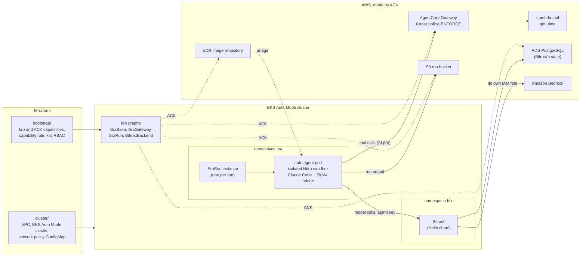

# Self-running agents: a short-lived agent whose tools come only through an AgentCore Gateway

## What this is

This sample runs one AI agent job at a time, the way a self-running repository agent
would. Each job is one headless Claude Code run in an isolated Nitro sandbox pod. The pod
is made for the job and deleted after it, and everything the job produced is copied out
first.

The agent has no tools of its own. Its only tools come through an Amazon Bedrock
AgentCore Gateway, which asks a Cedar policy about every call. Its model calls go through
[Bifrost](bifrost/README.md), a model gateway in the cluster, so the agent's own IAM role
has no Bedrock permission.

It deploys a VPC and an EKS Auto Mode cluster (or uses yours), kro and ACK, an AgentCore
Gateway with a Cedar policy and a Lambda tool, an S3 run bucket and an ECR repository, and
Bifrost with its RDS PostgreSQL database.

Everything is code: Terraform for the cluster and the controllers, kro graphs for the
sample's own resources, and Helm for Bifrost's chart. Scripts apply them, upload the tool's
code, push the image and make Bifrost's four Secrets.

```bash
git clone -b self-running-agents-kro https://github.com/utkarpun/sample-eks-nitro-sandbox.git
cd sample-eks-nitro-sandbox/examples/agent-sandbox/self-running-agents
```

## Prerequisites

- **A cluster.** An EKS Auto Mode cluster with Nitro sandboxes and network policy
  enforcement on. Make one with Terraform in [`cluster/`](cluster/README.md), or use an
  Auto Mode cluster you already have. `setup.sh` checks both.
- **Tools.** Terraform 1.5.7 or later; Docker with `linux/amd64` builds; the AWS CLI v2
  2.32.8 or later (the first with the AgentCore Policy commands `cleanup.sh` reads back
  with, [changelog](https://github.com/aws/aws-cli/blob/v2/CHANGELOG.rst#2328)); `kubectl`
  within one minor version of the cluster; `helm` 3, `python3`, `openssl` and `sha256sum`.
- **AWS access.** Credentials that can run [`cluster/`](cluster/README.md) if you use it (a
  VPC, an EKS cluster, its IAM roles, KMS key and log group),
  [`bootstrap/`](bootstrap/README.md) (an IAM role, EKS capabilities, an access policy
  association, and a ClusterRole on the cluster) and the scripts (read the cluster, push to
  the sample's ECR repository, write and empty its run bucket, apply kro graphs, and
  simulate IAM roles for `test.sh`). Every other AWS resource is made by the ACK
  capability's role.
- **Bedrock and AgentCore.** Access to the Bedrock model in `.env`, and AgentCore Gateway
  and AgentCore Policy in your Region (written for `us-west-2`).

**What it costs.** Beyond the cluster: the Bedrock tokens the agent spends, the gateway's
tool calls, one Lambda call per tool call, and the node EKS Auto Mode starts for the
sandbox pod when no node has room (the pod asks for 1 vCPU and 2Gi). Between runs:
Bifrost's pod and the node it runs on, the image in ECR, the objects in the run bucket, and Bifrost's PostgreSQL database on Amazon
RDS, which bills until `bifrost/destroy.sh` ends with `clean up complete`
([what it costs](bifrost/README.md#what-it-costs)).

## Overview and architecture



| Piece | What it is | Folder |
|---|---|---|
| The cluster | VPC, EKS Auto Mode cluster, network policy enforcement | [`cluster/`](cluster/README.md) |
| The controllers | The EKS managed kro and ACK capabilities and their role | [`bootstrap/`](bootstrap/README.md) |
| The sample's resources | Three kro graphs: `SraBase`, `SraGateway`, `SraRun`; Bifrost's `BifrostBackend` is the fourth | [`kro/`](kro/README.md) |
| The tool door | An AgentCore Gateway with a Cedar policy engine in `ENFORCE` mode | [`kro/AGENTCORE.md`](kro/AGENTCORE.md) |
| The tool | A Lambda function with two read-only tools, `get_time` and `get_host_info` | [`tool/`](tool/README.md) |
| The agent | Claude Code with `-p`, one prompt, then exit, and the bridge `mcp-proxy-for-aws-cli` | [`agent/`](agent/README.md) |
| The model gateway | Bifrost, which calls Bedrock with its own role | [`bifrost/`](bifrost/README.md) |
| The run | One `SraRun` instance per run, made by `run.sh` | [`deploy/`](deploy/README.md) |
| The scripts | Set up, run, test and clean up | [`scripts/`](scripts/README.md) |

A run goes like this:

1. `scripts/run.sh` makes an `SraRun` instance. kro makes its one child, the run's Job.
2. The pod waits until its egress rule is in force (the egress gate,
   [agent/](agent/README.md)).
3. Claude Code starts the bridge, which lists the gateway's tools as the pod's IAM role.
   The gateway lists only what the Cedar policy permits that role: `clock___get_time`.
4. The model calls `clock___get_time`. The gateway asks the policy engine, the policy
   permits it, and the gateway invokes the Lambda function.
5. The pod copies the run's output to the run bucket and exits. `run.sh` deletes the
   `SraRun`, then the pod.

Never delete a run's Job by hand: delete its `SraRun`, then its pod
([why](kro/README.md#what-srarun-makes)).

## How to run it

The output on this page will come from one fresh run on a cluster that had none of the
sample's resources. The account id is replaced with `<ACCOUNT_ID>`, the cluster name with
`<CLUSTER_NAME>`, and the generated ids of the gateway, the policy engine and the Pod
Identity association with `<id>`; long blocks are abridged where marked. The `sra:`
prefix on the pod's own lines is fixed in `agent/run.sh`. The `SraRun` form of the run has
not yet run on a cluster.

**Make the cluster** (skip this on your own cluster). Give your own address for the API
endpoint. Details, and why two applies: [`cluster/`](cluster/README.md).

```bash
cd cluster
terraform init
terraform apply -target=module.vpc -target=module.eks -var 'endpoint_public_access_cidrs=["<your IP>/32"]'
terraform apply -var 'endpoint_public_access_cidrs=["<your IP>/32"]'
aws eks update-kubeconfig --name sandbox-demo --region us-west-2
cd ..
```

```text
TODO: output from the fresh run
```

**Step 0: turn on kro and ACK.** Once per cluster. After a pull, run Step 0, Step 2 and
Step 2b again. On the `cluster/` path `<CLUSTER_NAME>` is `sandbox-demo`, unless you set
`cluster_name`. Details: [`bootstrap/`](bootstrap/README.md).

```bash
cd bootstrap
terraform init
terraform plan -var cluster_name=<CLUSTER_NAME> -var region=us-west-2 -out tfplan
terraform apply tfplan
cd ..
```

```text
TODO: output from the fresh run
```

**Step 1: copy the settings and fill them in.**

```bash
cp .env.example .env
# set CLUSTER_NAME, and KUBE_CONTEXT (a context in your kubeconfig) to pin the cluster
```

`KUBE_CONTEXT` must be the context of `CLUSTER_NAME`: the Pod Identity association is made
on `CLUSTER_NAME` and the pods run on the context. On a mismatch the pods get no
credentials, and the scripts apply and delete the sample's graphs on the context's cluster;
nothing checks that the two match. After `aws eks update-kubeconfig`, the context is the cluster's ARN, which
`kubectl config current-context` prints. Set `AWS_PROFILE` too if the cluster's account is
not your CLI's default.

**Step 2: set everything up.** `setup.sh` checks the cluster, applies the three graphs,
uploads the tool's code, pushes the agent image and waits until the `SraGateway` instance is
`ACTIVE`. If it stops part way, run it again. Details: [`scripts/`](scripts/README.md).

```bash
./scripts/setup.sh
```

```text
TODO: output from the fresh run
```

**Step 2b: set up Bifrost.** It needs the namespace `sra` that `setup.sh` made. Its graph
copies the agent's key into `sra`, and `run.sh` and `test.sh` refuse to start without that
key. Details: [`bifrost/`](bifrost/README.md).

```bash
./bifrost/apply.sh
```

**Step 3: start one agent run.** The agent reads the time through the gateway and reports
it. (The output below is from the agent run `test.sh` starts as its first check, T, in
Step 4; `run.sh` prints the same.)

```bash
./scripts/run.sh
```

```text
TODO: output from the fresh run
```

The tool calls and the result, read from that run's stream:

```text
TODO: output from the fresh run
```

**Step 4: check it both ways.** `test.sh` runs the agent once (the run in Step 3), then
each refusal. What each check proves: [`scripts/`](scripts/README.md#what-testsh-checks).

```bash
./scripts/test.sh
```

```text
TODO: output from the fresh run
```

The tool function's own log shows that only `get_time` reached it (at least 3 from
`test.sh`; one more if you ran Step 3 first):

```text
TODO: output from the fresh run
```

**Clean up.** In this order, from this folder of the clone that ran the setup, with the
same `.env` and credentials. Each step needs the one before it to end clean. The full list
of reads that prove everything is gone is in
[`scripts/`](scripts/README.md#check-that-everything-is-gone).

1. On the `cluster/` path, note the cluster's KMS key ARN while the cluster is up (the
   destroy removes its alias):

   ```bash
   aws eks describe-cluster --name <CLUSTER_NAME> --region us-west-2 \
     --query 'cluster.encryptionConfig[0].provider.keyArn' --output text
   ```

2. Remove Bifrost, then the sample. Each script is done when its last line is `clean up
   complete`; if not, the lines above say what is left, so run it again. A database left
   behind keeps billing, and its security group blocks the VPC delete. If you turned on
   bucket versioning, empty the bucket in the S3 console first: `cleanup.sh` removes only
   current objects. Run both before step 3: with kro or ACK gone they cannot finish (see
   [`scripts/`](scripts/README.md#if-kro-or-ack-is-already-gone)).

   ```bash
   ./bifrost/destroy.sh
   ./scripts/cleanup.sh
   ```

   ```text
   TODO: output from the fresh run
   ```

3. Remove kro and ACK, only if nothing else on the cluster uses them. Both scripts in step 2
   must have ended `clean up complete` first, because the capabilities keep what their
   graphs made when they are deleted.

   ```bash
   cd bootstrap
   terraform destroy -var cluster_name=<CLUSTER_NAME> -var region=us-west-2
   cd ..
   aws eks list-capabilities --cluster-name <CLUSTER_NAME> --region us-west-2
   ```

   Done when the destroy ends `Destroy complete!` and the list no longer shows `sra-ack` or
   `sra-kro`.

   ```text
   TODO: output from the fresh run
   ```

4. On the `cluster/` path, remove the cluster. If the destroy stops on the VPC, see
   [`cluster/`](cluster/README.md#if-the-destroy-stops-on-the-vpc).

   ```bash
   cd cluster
   terraform destroy -var 'endpoint_public_access_cidrs=["<your IP>/32"]'
   cd ..
   ```

   ```text
   TODO: output from the fresh run
   ```

5. Check that everything is gone: [`scripts/`](scripts/README.md#check-that-everything-is-gone).

## Design

**Terraform for the base, Helm for other people's charts, kro for ours.** Every resource
that is ours, in AWS and in the cluster, is a kro graph whose AWS objects the AWS
Controllers for Kubernetes (ACK) make; both controllers are EKS managed capabilities. The
one exception is Bifrost's four Secrets, which `bifrost/apply.sh` makes
([why](bifrost/README.md#what-is-in-this-folder)).

**One narrow role per piece.** The agent pod's ServiceAccount maps to one IAM role through
EKS Pod Identity. That role may call `bedrock-agentcore:InvokeGateway` on the one gateway
and put objects under `runs/` in the run bucket, nothing else. The model calls go through
Bifrost, whose own role holds the Bedrock permission. This follows the EKS Best Practices
Guide's "Use one IAM role per application" ([*Identity and Access
Management*](https://docs.aws.amazon.com/eks/latest/best-practices/identity-and-access-management.html)).

**Every tool call is decided outside the sandbox.** The gateway knows the caller by its
SigV4 signature and asks a Cedar policy, which permits only `clock___get_time` for the
agent's role. Cedar denies by default. Whoever can change the gateway can turn the policy
off. Inside the pod, Claude
Code's built-in tools are off (`--tools ""`) and `agent/settings.json` allows only the
gateway. More: [`kro/AGENTCORE.md`](kro/AGENTCORE.md).

**No Kubernetes API token, sandbox only.** The pod turns off token automount, and an
admission policy refuses any pod in the namespace that leaves it on or does not run in
`isolated-sandbox`. More: [`kro/`](kro/README.md).

**Egress by name.** An egress rule lets the agent pods reach DNS, the Pod Identity agent,
Bifrost, and two names on 443: the gateway and the run bucket. The agent waits for that rule
before it starts (the egress gate, [`agent/`](agent/README.md)).

**State outside the pod.** The pod keeps nothing; its output goes to the run bucket
([`agent/`](agent/README.md#what-a-run-does)).

**A plain Job, not a SandboxTemplate.** No controller adds a network policy of its own, so
the egress rule is the only one. The price is cold start.

**What this sample does not limit.** This list is not complete. The agent cannot use any of
these today, because it has no tool that runs code or opens a connection. A repository agent
given Bash, file tools or a credential can, so close them before you add such a tool, or let
anyone else create pods in the namespace.

- **Name rules match addresses.** The egress rule's names resolve to addresses, and a host
  that shares an address with an allowed name is reachable too (Amazon EKS User Guide,
  [*Use Network Policies with EKS Auto Mode*](https://docs.aws.amazon.com/eks/latest/userguide/auto-net-pol.html)).
  On this cluster the learned addresses were shared by every pod on the node. Every S3
  bucket in the Region shares the run bucket's addresses, and a public bucket can be read
  and written with no role.
- **DNS is open.** Port 53 is allowed to any address, and every name still resolved from an
  agent pod, so treat DNS as a channel out. The EKS Best Practices Guide's example allows
  DNS only to `kube-dns` ([*Network
  security*](https://docs.aws.amazon.com/eks/latest/best-practices/network-security.html)).
- **The window before the policy.** The egress gate keeps the agent from starting during it
  when the canary is reachable, but the window exists for every pod in the namespace. The
  NodeClass's `networkPolicy: DefaultDeny` closes it for every node of the NodePools that
  use that NodeClass (Amazon EKS User Guide,
  [*Create a Node Class for Amazon EKS*](https://docs.aws.amazon.com/eks/latest/userguide/create-node-class.html)).
  Not exercised by this sample.
- **The model call.** The agent's key travels to Bifrost over plain HTTP inside the cluster.
  It is limited to one model and a request and token rate, with no spend budget ([Stop
  it](bifrost/README.md#stop-it)). Nothing inspects prompts or tool results. Bedrock records
  the calls as Bifrost's role: CloudTrail logs each `InvokeModel`, CloudWatch counts
  invocations and tokens per model (`AWS/Bedrock`), and model invocation logging, if you
  turn it on, keeps the bodies.
- **No in-guest policy.** An isolated sandbox runs no in-guest policy unless one is supplied
  (Amazon EKS User Guide,
  [*Sandboxing on Amazon EKS with isolated and confidential pods*](https://docs.aws.amazon.com/eks/latest/userguide/sandboxing.html)),
  and this sample supplies none. The Cedar policy here is the gateway's, in AWS.
- **Admission checks two fields.** It does not refuse a privileged container, a `hostPath`
  volume, `hostNetwork`, a Secret in `env` or a token mounted on purpose as a projected
  volume, and an isolated sandbox does not refuse the first two either; a `hostNetwork` pod
  fails to start in a sandbox (Amazon EKS User Guide,
  [*Considerations*](https://docs.aws.amazon.com/eks/latest/userguide/sandboxing-limitations.html)).
- **Only labelled pods are under the egress rule.** A pod without the label
  `app.kubernetes.io/name: agent` but with `serviceAccountName: agent` gets the agent's AWS
  credentials and the cluster's default egress (`DefaultAllow` here). Keep `create pods` in
  the namespace to yourself. Creating a `SraRun` gives the same: kro makes its Job, and any
  `image` runs as `agent` with its Pod Identity role and the Bifrost key. Keep `create` on
  `sraruns` to yourself too, and `create` on `bifrostbackends` to cluster admins: an
  instance can make, label and later delete the namespace it names and write the agent's
  key into the namespace `agentNamespace` names.
- **Whoever can create ACK objects holds the ACK role**, which can make an admin role
  ([`bootstrap/`](bootstrap/README.md)).
- **Instance metadata.** An isolated sandbox runs its own IMDSv2 service at
  `169.254.169.254`, inside the sandbox, so the egress rule does not reach it. It serves only
  the Region, Availability Zone, Availability Zone ID, services domain and partition, and 404
  for everything else, credentials included (Amazon EKS User Guide,
  [*Pod Identity and credentials*](https://docs.aws.amazon.com/eks/latest/userguide/sandboxing-metadata-credentials.html)).
  A sandbox Cedar policy generated with `--deny-imds` turns it off; generate it with
  `--with-pod-identity` as well, or the pod's AWS calls fail.
- **The role works without the gateway.** The pod's AWS credentials reach the run bucket
  directly; only tool calls pass the gateway's policy.
- **Every allowed name is a public endpoint.** AgentCore Gateway, S3 and Bedrock each have
  interface VPC endpoints (the gateway's is
  `com.amazonaws.<Region>.bedrock-agentcore.gateway`); this sample uses the public ones.

**Extending it.** Three seams: your own prompt ([`kro/`](kro/README.md#good-to-know)), a
repository checkout for the agent (a step in `agent/run.sh` before Claude Code starts, with
the repository's host added to the egress rule), and more tools as extra `GatewayTarget`
resources, each with its own Cedar `Policy`. Read the list above before you give the agent a
tool that runs code or opens a connection.

### Versions

| Component | Pin |
|---|---|
| Claude Code | `2.1.310` (Dockerfile) |
| `mcp-proxy-for-aws-cli` | `1.8.0` (Dockerfile; it pins its own dependency tree) |
| Base image | `public.ecr.aws/docker/library/node:22-bookworm-slim` (tag, not a digest) |
| Lambda runtime | `python3.13` |
| Terraform providers | `hashicorp/aws` 6.73.0, `hashicorp/kubernetes` 3.5.0 (`bootstrap/` and `cluster/` lock files) |
| Terraform modules (`cluster/`) | `terraform-aws-modules/vpc/aws` 6.7.3, `terraform-aws-modules/eks/aws` 21.29.0 |
| Bifrost Helm chart | `2.1.48` (`bifrost/lib.sh`) |
| kro and ACK capabilities | EKS managed; this run: `TODO: output from the fresh run` (`terraform -chdir=bootstrap output kro_version && terraform -chdir=bootstrap output ack_version`) |
| EKS | Auto Mode; this run: `TODO: output from the fresh run` |
| AWS CLI | `TODO: output from the fresh run` for this run |
